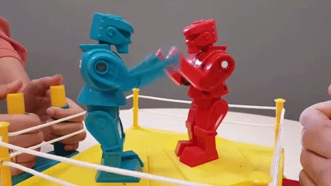

# Red vs Blue



One finding, one fight. Red argues the finding is real and finds the
concrete input that breaks the code. Blue reproduces it or refutes it, and
"seems fine" is not a refutation. The gate scores what is left. A review
comment goes in; a scored verdict comes out: Survives or Falls.

Brawl sends every finding it raises through its own fight, so each one is
settled before a reviewer ever sees it. You can also bring one yourself: a
PR comment from a teammate, a bug report, a claim you doubt.

## The reference

Designed after the red and blue teams of Team Fortress 2, RED and BLU, and
pictured here as Rock 'Em Sock 'Em Robots, the Mattel toy where two people
work two boxers until one head pops. Both fighters are built the same and
differ only in color and corner. That is the point: Red and Blue are the
same model with opposite mandates, and the signal comes from the fight, not
from who is smarter. The gif is a fan recording used as a mascot; the toy
belongs to Mattel.

## What it expects to find

- One finding or comment, and the code or diff it is about.
- `standards/finding.md` for the shape of a finding, and
  `standards/severity.md` for the evidence ladder and the scores.
- The standard behind the finding, when there is one.
- The repo's own rules, `AGENTS.md` and the touched `SPEC.md`. A rule that
  makes the behavior intended ends the fight.

## How it is called

```
/red-vs-blue "<comment or finding>"   settle one finding
/red-vs-blue --cross "<finding>"      run Red on a second model family through its CLI
```

Or say it: "red vs blue this", "fight this finding", "is this comment
real?". Brawl calls it once per finding.

## Rules of engagement

1. Red and Blue never see the author's reasoning. They get the finding, the
   code, the standard, and the repo's rules.
2. A claim needs a place and a failure path. Static reading caps at
   Important. Only a run or a reproduction earns Critical.
3. The gate scores confidence from 0 to 100 and drops anything under 80.
4. Red never sees Blue's answer. Blue answers Red's case.

## Hard stops

Red never fixes. Blue never argues taste. The gate never adds a finding of
its own.
